# n8n-apify-hubspot-competitor-pricing-page-diff-tracker

> Market intelligence pipeline that scrapes competitor pricing pages via Apify on a weekly cron schedule, computes structural diffs, and logs pricing model shifts into HubSpot competitor custom objects.

    

Every Monday at 06:00 UTC the workflow scrapes each tracked competitor's pricing page with an Apify actor, normalises the result into a canonical tier/feature model, and diffs it against last week's valid snapshot stored in HubSpot. It scores each change (price moves, tier additions and removals, pricing-model shifts, contact-sales moves, feature gating, seat limits, annual discounts), upserts one HubSpot custom-object record per competitor per ISO week, and posts a Slack Block Kit digest to RevOps.

**Safe by default:** imported as-is, the workflow runs on synthetic fixtures, makes **zero** external API calls, writes **nothing** to HubSpot and sends **nothing** to Slack.

---

## Table of contents

1. [Repository layout](#repository-layout)
2. [Architecture overview](#architecture-overview)
3. [Prerequisites](#prerequisites)
4. [5-minute sandbox quick start](#5-minute-sandbox-quick-start)
5. [Step-by-step import and configuration](#step-by-step-import-and-configuration)
6. [Environment variables](#environment-variables)
7. [HubSpot custom object](#hubspot-custom-object)
8. [Apify actor contract](#apify-actor-contract)
9. [Pricing diff algorithm](#pricing-diff-algorithm)
10. [Threshold and severity logic](#threshold-and-severity-logic)
11. [Slack alert format](#slack-alert-format)
12. [Offline simulator](#offline-simulator)
13. [RevOps best practices](#revops-best-practices)
14. [Safety matrix](#safety-matrix)
15. [Data protection and compliance checklist](#data-protection-and-compliance-checklist)
16. [Troubleshooting](#troubleshooting)
17. [Disclaimer and license](#️-disclaimer--liability-limitation)

---

## Repository layout

```text
n8n-apify-hubspot-competitor-pricing-page-diff-tracker/
├── workflow.json                                  # Import into n8n (24 nodes, inactive on import)
├── README.md                                      # This file
├── DISCLAIMER.md                                  # Liability limitation
├── LICENSE                                        # MIT © 2026 DH Robin (dhRobin Systems)
├── .env.example                                   # Placeholder environment template
├── .gitignore
├── sample-payloads/
│   ├── competitor-pricing-fixture.json            # Synthetic previous + current snapshots (5 scenarios)
│   └── hubspot-custom-object-schema.json          # One-time POST /crm/v3/schemas body
└── scripts/
    └── simulate-sandbox-run.js                    # Offline runner for every Code node in workflow.json
```

---

## Architecture overview

```mermaid
flowchart LR
    subgraph Triggers
        A1[Weekly Schedule Trigger<br/>cron 0 6 * * 1 · UTC]
        A2[Manual Test Trigger]
    end

    A1 --> B[Config & Safety Gate<br/>reads $env · derives gates]
    A2 --> B
    B --> C{Route:<br/>Sandbox or Live?}

    C -- sandbox --> D[Load Sandbox Fixture<br/>synthetic snapshots]
    C -- live --> E[Build Live Targets<br/>COMPETITOR_TARGETS_JSON]
    E --> F[[Apify: Run Pricing<br/>Scraper Actor]]
    F --> G[Attach Apify Result]
    G --> H[[HubSpot: Fetch Previous<br/>Snapshot · search]]
    H --> I[Assemble Live<br/>Snapshot Pairs]

    D --> J[Pricing Diff &<br/>Intelligence Engine]
    I --> J
    J --> K[Build HubSpot Batches]
    K --> L{Gate: Live CRM<br/>Write Allowed?}
    L -- yes --> M[[HubSpot: Batch Upsert<br/>Snapshots]]
    M --> N[Collect HubSpot<br/>Write Results]
    L -- no --> O[Dry-Run Write Preview]

    N --> P[RevOps Slack Block<br/>Kit Builder]
    O --> P
    P --> Q{Gate: Slack<br/>Send Allowed?}
    Q -- yes --> R[[Slack: Post<br/>RevOps Alert]]
    Q -- no --> S[Slack Alert Skipped]
    R --> T[Execution Summary & Audit]
    S --> T
    T --> U{Gate: Ops<br/>Alert Needed?}
    U -- yes --> V[[Ops: Post Failure Alert]]

    classDef ext fill:#fff4e6,stroke:#ff7a59;
    classDef gate fill:#eef6ff,stroke:#3b82f6;
    class F,H,M,R,V ext;
    class C,L,Q,U gate;
```



Double-bordered nodes are the only nodes that make network calls. Every one of them sits behind a gate that is **closed by default**.

| # | Node | Type | Purpose |
|---|------|------|---------|
| 1 | Weekly Schedule Trigger | Schedule | Cron `0 6 * * 1` (Monday 06:00, workflow timezone UTC) |
| 2 | Manual Test Trigger | Manual | Click-to-run for testing |
| 3 | Config & Safety Gate | Code | Reads env vars, applies safe defaults, validates targets, derives `allowHubspotWrite` / `allowSlackSend` / `allowOpsAlert`, never copies secret values |
| 4 | Route: Sandbox or Live? | IF | `sandboxMode === true` → fixtures |
| 5 | Load Sandbox Fixture | Code | Emits the embedded synthetic fixture (mirrors `sample-payloads/competitor-pricing-fixture.json`) |
| 6 | Build Live Targets | Code | One item per competitor with Apify actor input |
| 7 | Apify: Run Pricing Scraper Actor | HTTP | `POST /v2/acts/{actor}/run-sync-get-dataset-items`, text response so items stay 1:1 |
| 8 | Attach Apify Result | Code | Parses dataset, pairs by index, builds HubSpot search body |
| 9 | HubSpot: Fetch Previous Snapshot | HTTP | `POST /crm/v3/objects/{type}/search` for the latest **valid** snapshot from a **previous** week |
| 10 | Assemble Live Snapshot Pairs | Code | Builds `{ current, previous }`; a failed lookup is an error, never a silent baseline |
| 11 | Pricing Diff & Intelligence Engine | Code | Normalise → fingerprint → structural diff → severity → HubSpot upsert inputs |
| 12 | Build HubSpot Batches | Code | Chunks inputs (≤ 100 per batch); always emits ≥ 1 item |
| 13 | Gate: Live CRM Write Allowed? | IF | `allowWrite === true` |
| 14 | HubSpot: Batch Upsert Snapshots | HTTP | `POST /crm/v3/objects/{type}/batch/upsert` keyed on unique `snapshot_key` |
| 15 | Collect HubSpot Write Results | Code | Per-batch success/failure accounting |
| 16 | Dry-Run Write Preview | Code | Shows endpoint, record keys and a sample record without writing |
| 17 | RevOps Slack Block Kit Builder | Code | Builds the digest (always built, so it can be previewed) |
| 18 | Gate: Slack Send Allowed? | IF | `allowSend === true` |
| 19 | Slack: Post RevOps Alert | HTTP | Incoming webhook from `$env.SLACK_PRICING_ALERT_WEBHOOK_URL` |
| 20 | Slack Alert Skipped | Code | Records the skip reason |
| 21 | Execution Summary & Audit | Code | Secret-free audit record + checksum; decides on ops alert |
| 22 | Gate: Ops Alert Needed? | IF | `needsOpsAlert === true` |
| 23 | Ops: Post Failure Alert | HTTP | Generic JSON webhook from `$env.ALERT_WEBHOOK_URL` |
| — | Safety Notes | Sticky note | On-canvas reminder of the gates |

All HTTP nodes use `credentials: none` with `Authorization: Bearer {{ $env.… }}` headers, retry 3× with 3 s back-off, `onError: continueRegularOutput` (failures are reported rather than crashing the run), and batching (one request at a time with a delay) to respect rate limits.

---

## Prerequisites

| Requirement | Notes |
|---|---|
| n8n (self-hosted) | 1.x or newer with the Code node (v2), IF node (v2.2), HTTP Request node (v4.2). n8n Cloud does not let you set custom environment variables; on Cloud, replace `$env.X` with `$vars.X` (Variables) or n8n credentials. |
| `$env` access | Code nodes and expressions must be able to read env vars: set `N8N_BLOCK_ENV_ACCESS_IN_NODE=false` on the n8n instance. If access is blocked, the Config node falls back to sandbox + dry-run automatically. |
| Node.js ≥ 18 | Only for the offline simulator. No npm dependencies. |
| HubSpot | A **developer test account or sandbox** for staging. A plan that supports custom objects (Enterprise tier) for production. |
| HubSpot private app scopes | **`crm.objects.custom.read`** (previous-snapshot search) and **`crm.objects.custom.write`** (batch upsert). For the one-time schema creation only: `crm.schemas.custom.write` (and `crm.schemas.custom.read` to verify). Remove the schema scopes afterwards. |
| Apify | An account with an API token (Settings → Integrations) and an actor that returns the [snapshot contract](#apify-actor-contract). Actor runs consume Apify platform credits. |
| Slack (optional) | An incoming webhook for a private RevOps channel. |
| Ops webhook (optional) | Any HTTPS endpoint that accepts JSON (incident tool, Teams, etc.). |

---

## 5-minute sandbox quick start

No accounts, tokens or network access needed.

```bash
# 1. Run the offline simulator against workflow.json (synthetic data, zero HTTP calls)
node scripts/simulate-sandbox-run.js
```

Expected result: five synthetic competitors, `All 35 checks passed.`

| Competitor (synthetic) | Scenario | Expected status / severity |
|---|---|---|
| CompetitorAlpha Inc (`comp_001`) | Pro +14.3 % / +15.4 %, new contact-sales Enterprise tier, SSO gated up to Business, seat limit 50 → 40, Starter annual discount −5.3 pp | `changed` · **critical** |
| BetaMetrics Corp (`comp_002`) | `per_seat` → `usage_based`, Team tier replaced by Growth, Scale moved to contact sales, free trial removed | `changed` · **critical** |
| GammaLedger Labs (`comp_003`) | Structurally identical (EUR) | `no_change` |
| DeltaSignal Co (`comp_004`) | No previous snapshot | `baseline` |
| EpsilonGrid Ltd (`comp_005`) | Scrape returned zero tiers | `review_required`, `snapshot_valid=false` |

```bash
# 2. Import into n8n (UI: Workflows → Import from File → workflow.json), or via CLI:
n8n import:workflow --input=workflow.json

# 3. Open the workflow and click "Test workflow" (Manual Test Trigger).
#    Inspect "Dry-Run Write Preview" and "RevOps Slack Block Kit Builder" outputs.
#    Paste the Builder's payload.blocks into Slack's Block Kit Builder to preview it.
```

---

## Step-by-step import and configuration

1. **Import.** Import `workflow.json`. It arrives **inactive**, with no credentials attached.
2. **Run in sandbox.** Execute with the Manual Test Trigger. Confirm `Config & Safety Gate` shows `modeLabel: "SANDBOX"` and every `allow*` gate is `false`.
3. **Create the HubSpot custom object** in a developer test account:
   ```bash
   # Remove the "_comment" key first. Uses a schema-scoped token, once.
   curl -X POST https://api.hubapi.com/crm/v3/schemas \
     -H "Authorization: Bearer $HUBSPOT_SCHEMA_SETUP_TOKEN" \
     -H "Content-Type: application/json" \
     --data @sample-payloads/hubspot-custom-object-schema.json
   ```
   Note the returned `fullyQualifiedName` (`p<portalId>_competitor_pricing`) or `objectTypeId` (`2-…`) and set `HUBSPOT_COMPETITOR_OBJECT_TYPE` to it.
4. **Create a HubSpot private app** with `crm.objects.custom.read` + `crm.objects.custom.write`. Put the token in `HUBSPOT_ACCESS_TOKEN` on the n8n host (environment, secrets manager or Docker secret; never in the workflow).
5. **Configure Apify.** Set `APIFY_API_TOKEN` and `APIFY_ACTOR_ID` (`username~actor-name` form). Test the actor once in the Apify console against a single target page and confirm its output matches the [contract](#apify-actor-contract).
6. **Define targets.** Set `COMPETITOR_TARGETS_JSON` (single-line JSON array). Each entry needs a lowercase `competitorKey` slug, `competitorName` and an `https://` `pricingUrl`; `hubspotRecordId` is optional.
7. **Live dry run.** Set `SANDBOX_MODE=false`, keep `DRY_RUN=true`. Restart n8n so it picks up the env vars. This runs Apify and the **read-only** HubSpot search, then previews writes. Check `modeLabel: "LIVE-DRY-RUN"`.
8. **Enable CRM logging.** Set `DRY_RUN=false` and `HUBSPOT_LOGGING_ENABLED=true`. Run manually; verify records in HubSpot (`competitor-alpha__2026-W47` style keys). Re-running in the same week upserts the same records instead of creating duplicates.
9. **Enable Slack.** Set `SEND_SLACK_ALERTS=true` and `SLACK_PRICING_ALERT_WEBHOOK_URL`. Optionally `SEND_OPS_ALERTS=true` + `ALERT_WEBHOOK_URL`.
10. **Activate.** Toggle the workflow active. It runs every Monday 06:00 UTC. To change the cadence, edit the cron on `Weekly Schedule Trigger`. Keep it at weekly or less frequent.

> **Promotion rule:** move one flag at a time, in the order above, and run the simulator after any workflow edit.

---

## Environment variables

| Variable | Default when unset | Required for | Description |
|---|---|---|---|
| `SANDBOX_MODE` | `true` | — | `true` → synthetic fixtures, no Apify/HubSpot calls. Forced back to `true` if live prerequisites are missing. |
| `DRY_RUN` | `true` | — | `true` blocks every mutation (HubSpot writes, Slack, ops alerts). Live reads still run when sandbox is off. |
| `HUBSPOT_LOGGING_ENABLED` | `false` | CRM writes | Explicit opt-in for HubSpot batch upserts. |
| `SEND_SLACK_ALERTS` | `false` | Slack | Explicit opt-in for Slack posts. |
| `SEND_OPS_ALERTS` | `false` | Ops alerts | Explicit opt-in for failure / review alerts. |
| `HUBSPOT_ACCESS_TOKEN` | — | Live | Private app token (`crm.objects.custom.read`, `crm.objects.custom.write`). **Secret.** |
| `HUBSPOT_PORTAL_ID` | `99000001` | Audit only | Shown in previews and the audit record. |
| `HUBSPOT_COMPETITOR_OBJECT_TYPE` | `p99000001_competitor_pricing` | Live | Fully qualified name or `2-xxxxxxx` object type ID. |
| `HUBSPOT_BATCH_SIZE` | `50` | — | Records per upsert batch (1–100). |
| `APIFY_API_TOKEN` | — | Live | Apify API token. **Secret.** |
| `APIFY_ACTOR_ID` | `mock-user~pricing-page-scraper` | Live | Actor that returns the snapshot contract. |
| `APIFY_RUN_TIMEOUT_SECS` | `240` | — | Sync-run timeout (30–290 s). |
| `APIFY_ACTOR_INPUT_JSON` | `{}` | — | Extra actor input merged into each run (e.g. proxy settings). |
| `COMPETITOR_TARGETS_JSON` | `[]` | Live | JSON array of `{competitorKey, competitorName, pricingUrl, hubspotRecordId?}`. |
| `PRICE_CHANGE_THRESHOLD_PCT` | `5` | — | Price moves ≥ this are material (high); increases ≥ 2× are critical. |
| `ANNUAL_DISCOUNT_SHIFT_THRESHOLD_PP` | `5` | — | Annual-vs-monthly discount shift (percentage points) that counts as a change. |
| `SUSPECT_TIER_REMOVAL_RATIO` | `0.5` | — | If more than this share of tiers vanishes in one run, the snapshot is flagged for review. |
| `ALERT_MIN_SEVERITY` | `high` | — | Minimum severity that triggers a Slack alert (`low`/`medium`/`high`/`critical`). Review items always alert. |
| `SLACK_PRICING_ALERT_WEBHOOK_URL` | — | Slack | Incoming webhook URL. **Secret.** |
| `ALERT_WEBHOOK_URL` | — | Ops alerts | JSON webhook for failures. **Secret.** |
| `RUN_TIMESTAMP_OVERRIDE` | — | — | ISO timestamp to pin the run clock (backfills, reproducible tests). |
| `N8N_BLOCK_ENV_ACCESS_IN_NODE` | instance default | n8n instance | Must be `false` so the workflow can read the variables above. |

Unrecognised flag values (e.g. `SANDBOX_MODE=maybe`) resolve to the **safe** default and are recorded as warnings.

### Sample `.env`

```dotenv
# Safety flags
SANDBOX_MODE=true
DRY_RUN=true
HUBSPOT_LOGGING_ENABLED=false
SEND_SLACK_ALERTS=false
SEND_OPS_ALERTS=false

# HubSpot
HUBSPOT_ACCESS_TOKEN=replace-with-hubspot-private-app-token
HUBSPOT_PORTAL_ID=99000001
HUBSPOT_COMPETITOR_OBJECT_TYPE=p99000001_competitor_pricing

# Apify
APIFY_API_TOKEN=replace-with-apify-api-token
APIFY_ACTOR_ID=mock-user~pricing-page-scraper

# Targets (single line)
COMPETITOR_TARGETS_JSON=[{"competitorKey":"competitor-alpha","competitorName":"CompetitorAlpha Inc","pricingUrl":"https://competitor-alpha.example.com/pricing","hubspotRecordId":"comp_001"}]

# Thresholds
PRICE_CHANGE_THRESHOLD_PCT=5
ANNUAL_DISCOUNT_SHIFT_THRESHOLD_PP=5
ALERT_MIN_SEVERITY=high

# Webhooks
SLACK_PRICING_ALERT_WEBHOOK_URL=https://hooks.example.com/slack/pricing-alerts
ALERT_WEBHOOK_URL=https://alerts.example.com/ops/competitor-pricing

# n8n instance
N8N_BLOCK_ENV_ACCESS_IN_NODE=false
```

For Docker, pass the file with `docker run --env-file .env …` or `env_file:` in Compose. See `.env.example` for the full list.

---

## HubSpot custom object

`sample-payloads/hubspot-custom-object-schema.json` defines `competitor_pricing` with **one record per competitor per ISO week**. `snapshot_key` (`<competitorKey>__<YYYY-Www>`) is the primary display property and is **unique**, which makes `batch/upsert` idempotent.

| Property | Type | Notes |
|---|---|---|
| `snapshot_key` | text, unique | Upsert ID, e.g. `competitor-alpha__2026-W47` |
| `competitor_key` / `competitor_name` / `competitor_record_id` | text | `competitor_record_id` links to a parent competitor record such as `comp_001` |
| `snapshot_date` | date | Run date (UTC) |
| `snapshot_status` | enum | `changed`, `no_change`, `baseline`, `review_required` |
| `snapshot_valid` | bool | Only valid snapshots become the next baseline |
| `pricing_model`, `currency` | enum / text | Canonical model and ISO currency |
| `tier_count`, `lowest_paid_monthly_price`, `highest_listed_monthly_price` | number | Snapshot metrics |
| `change_severity` | enum | `none` → `critical` |
| `change_count`, `material_change_count`, `max_price_change_pct`, `price_increase_count`, `price_decrease_count`, `tiers_added_count`, `tiers_removed_count` | number | Diff metrics for reports and dashboards |
| `pricing_model_shift`, `requires_review`, `diff_truncated` | bool | Flags for workflows and list filters |
| `review_reasons`, `diff_summary`, `diff_json`, `snapshot_json` | multi-line text | ≤ 60,000 chars each |
| `snapshot_fingerprint`, `previous_snapshot_key`, `run_id` | text | Lineage and audit |

**How history works.** The previous-snapshot search filters on `competitor_key = X`, `snapshot_key ≠ this week`, `snapshot_valid = true`, sorted by `snapshot_date` descending, `limit 1`. So re-runs never diff a week against itself, and broken scrapes never become a baseline.

**Optional association.** If you keep a parent "Competitor" object, associate snapshots to it with the v4 associations API using `competitor_record_id`. That step is not included, so the write scope stays at the minimum.

---

## Apify actor contract

Use any actor (your own Web Scraper or Playwright `pageFunction`, or a custom actor) whose dataset items look like this:

```json
{
  "competitorKey": "competitor-alpha",
  "capturedAt": "2026-11-16T06:00:00.000Z",
  "currency": "USD",
  "pricingModel": "per_seat",
  "freeTrialDays": 14,
  "tiers": [
    {
      "id": "pro",
      "name": "Pro",
      "monthlyPrice": 56,
      "annualPricePerMonth": 45,
      "billingUnit": "per_seat_month",
      "seatLimit": 40,
      "includedSeats": 3,
      "isContactSales": false,
      "features": { "sso": false, "api_access": true, "dashboards": "30" }
    }
  ]
}
```

The normaliser is tolerant:
- `plans` is accepted for `tiers`, and a nested `pricing` object is accepted.
- Prices may be numbers or strings (`"$1,299.00"`, `"£25"`, `"Free"`, `"Contact sales"`).
- Seats may be numbers or `"unlimited"`.
- `features` may be an object (boolean, number or string values) or an array of names.
- Model aliases are mapped (`per_user` → `per_seat`, `metered` → `usage_based`, etc.).
- Duplicate tier IDs are de-duplicated.

The workflow sends `{ startUrls: [{url}], competitorKey, maxPagesPerCrawl: 1, outputSchema: "competitor-pricing-snapshot/v1", ...APIFY_ACTOR_INPUT_JSON }`.

---

## Pricing diff algorithm

1. **Normalise** both snapshots: slug tier IDs, parse prices, unify seat values, canonicalise features (sorted keys), map the pricing model to `per_seat | flat_rate | usage_based | tiered | hybrid | unknown`.
2. **Validate the scrape.** Zero tiers → `review_required`, diff skipped, `snapshot_valid=false`.
3. **Fingerprint.** Stable-stringify the structure (excluding `capturedAt`) and hash it with dual FNV-1a. Equal fingerprints → `no_change` fast path. No previous snapshot → `baseline`.
4. **Match tiers** by ID. Then detect renames: an unmatched removed/added pair in the **same position** with **identical prices** → `tier_renamed`. Remaining unmatched tiers → `tier_removed` / `tier_added`.
5. **Per matched tier**, compare:
   - contact-sales transitions (`moved_to_contact_sales`, `price_published`);
   - `billingUnit` (e.g. flat → per seat);
   - monthly and annual-per-month price (percent change; free → paid handled separately);
   - annual discount `(monthly − annual) / monthly` shift in percentage points;
   - `seatLimit` and `includedSeats`;
   - quantitative feature limits (`"25"` → `"30"`).
6. **Feature gating across the page.** For each feature, find the lowest-ranked tier offering it (ranked by monthly price, contact sales last). If that tier changed, emit `feature_gated_up` (moved up-market, an upsell-pressure signal) or `feature_gated_down`. New or vanished features → `feature_added` / `feature_removed`.
7. **Page-level signals:** `pricing_model_shift`, `currency_changed` (percentages suppressed), `free_trial_changed`, `free_tier_added` / `free_tier_removed`.
8. **Suspect-scrape guard.** If the removed-tier ratio exceeds `SUSPECT_TIER_REMOVAL_RATIO`, the diff is kept but the status becomes `review_required` and `snapshot_valid=false`.
9. **Emit** the result, a headline, metrics, and a HubSpot upsert input.

---

## Threshold and severity logic

With `T = PRICE_CHANGE_THRESHOLD_PCT` (default 5):

| Change type | Severity |
|---|---|
| `pricing_model_shift`, `moved_to_contact_sales` | **critical** |
| `price_increase` ≥ 2T | **critical** |
| `price_increase` / `price_decrease` ≥ T, free → paid | **high** |
| `tier_removed`, `billing_unit_changed`, `currency_changed`, `free_tier_added/removed` | **high** |
| `tier_added`, `feature_gated_up/down`, `feature_removed`, `seat_limit_changed`, `included_seats_changed`, `annual_discount_shift` (≥ `ANNUAL_DISCOUNT_SHIFT_THRESHOLD_PP`), `free_trial_changed`, `price_unpublished`, `price_published` (from contact sales) | medium |
| price moves < T, `tier_renamed`, `feature_added`, `feature_limit_changed`, `price_published` (single field) | low |

- **Competitor severity** = highest change severity.
- **Material changes** = high + critical.
- **Alert-worthy** = `severity ≥ ALERT_MIN_SEVERITY` **or** `requires_review`.

---

## Slack alert format

One digest per run (≤ 50 blocks, section text ≤ 3,000 chars, link unfurls off):

- **Header:** `Competitor pricing changes · 2026-W47`.
- **Context:** mode badge (`SANDBOX (synthetic data)` / `LIVE DRY RUN` / `LIVE`), run ID, counts, threshold.
- **Per alert-worthy competitor, sorted by severity** (max 10):
  - name, severity dot and pricing-page link;
  - headline (e.g. "4 price increases, 1 tier added … (max +15.4%)");
  - up to 6 change lines with icons, then "…and N more" pointing to the HubSpot `snapshot_key`;
  - a fields grid with model, tier count, entry paid price and max price move;
  - a review warning when needed.
- **Footer:** quiet competitors (no change / baseline) and the HubSpot outcome.

---

## Offline simulator

`scripts/simulate-sandbox-run.js` reads **`workflow.json` itself**, so what you test is what you import. It walks the connection graph from the Manual Test Trigger, runs every Code node with n8n-style `$input`, `$env`, `$('Node')` and `$execution`, and evaluates IF nodes with strict boolean checks. HTTP nodes never open a socket.

```bash
node scripts/simulate-sandbox-run.js                         # safe defaults, synthetic data
node scripts/simulate-sandbox-run.js --mock-live             # full live path with in-memory mocks
node scripts/simulate-sandbox-run.js --mock-live --fail-writes   # HubSpot 429 → errors + ops alert
node scripts/simulate-sandbox-run.js --block-env             # N8N_BLOCK_ENV_ACCESS_IN_NODE=true
node scripts/simulate-sandbox-run.js --set PRICE_CHANGE_THRESHOLD_PCT=20 --no-checks
node scripts/simulate-sandbox-run.js --env-file .env         # your config, secrets masked
node scripts/simulate-sandbox-run.js --fixture my-fixture.json --no-checks
node scripts/simulate-sandbox-run.js --json                  # print the audit record
```

The host's `process.env` is never passed through: only `--env-file` and `--set` values are visible to the workflow code.

**Checks performed:**
- **Static:** workflow inactive on import, UTC timezone, Monday 06:00 cron, every HTTP node authenticated via `$env` with no stored credentials, no secret-looking literals, only `example.com` and official API hosts referenced, embedded fixture identical to `sample-payloads/`.
- **Behavioural:** safe-default gates closed with zero HTTP calls, expected status and severity for all five scenarios, Block Kit limits respected, no secret value present in any node output.
- **Mock-live:** one Apify call per competitor, upsert executed, Slack sent, secrets masked.

The full report is written to `sim-output/last-run.json` (git-ignored). The exit code is non-zero on any failed check, so you can use it in CI.

---

## RevOps best practices

- **Verify before broadcasting.** Treat every alert as a lead: open the pricing page, confirm the change (and region/currency), then update battlecards.
- **Keep the cadence weekly.** Pricing pages rarely change daily; weekly runs limit load on competitor sites and Apify spend.
- **Tune thresholds per market.** High-ACV enterprise competitors may warrant `PRICE_CHANGE_THRESHOLD_PCT=3`; noisy SMB pages may need `10`.
- **Watch gating moves, not just prices.** `feature_gated_up` (e.g. SSO moved to a higher tier) is often a stronger packaging signal than a headline price change.
- **Use HubSpot reports.** Build dashboards on `change_severity`, `max_price_change_pct` and `pricing_model_shift` over `snapshot_date`; create a list or workflow on `requires_review = true`, assigned to a named owner.
- **Close the review loop.** When a flagged snapshot is confirmed correct, set `snapshot_valid = true` so it becomes the baseline; otherwise fix the actor selector.
- **Version your actor.** Pin an actor build. Re-test against the fixture contract when the actor or a competitor's page layout changes.
- **Restrict access.** Limit the custom object and Slack channel to RevOps, Product Marketing and leadership.
- **Rotate tokens** at least quarterly and immediately on staff changes.

---

## Safety matrix

| `SANDBOX_MODE` | `DRY_RUN` | `HUBSPOT_LOGGING_ENABLED` | `SEND_SLACK_ALERTS` | Data source | Apify run | HubSpot read | HubSpot write | Slack post |
|---|---|---|---|---|---|---|---|---|
| `true` *(default)* | `true` *(default)* | `false` *(default)* | `false` *(default)* | Synthetic fixture | ❌ | ❌ | ❌ preview | ❌ |
| `true` | `false` | any | `true` + webhook | Synthetic fixture | ❌ | ❌ | ❌ preview | ✅ labelled **SANDBOX** |
| `false` | `true` | any | any | Live scrape | ✅ | ✅ read-only | ❌ preview | ❌ |
| `false` | `false` | `false` | `false` | Live scrape | ✅ | ✅ | ❌ preview | ❌ |
| `false` | `false` | `true` | `false` | Live scrape | ✅ | ✅ | ✅ upsert | ❌ |
| `false` | `false` | `true` | `true` + webhook | Live scrape | ✅ | ✅ | ✅ upsert | ✅ |
| `false` | any | any | any, **missing token/targets** | Forced fixture | ❌ | ❌ | ❌ | per Slack gate |
| `$env` blocked | — | — | — | Forced fixture | ❌ | ❌ | ❌ | ❌ |

Ops alerts follow the Slack pattern: `SEND_OPS_ALERTS=true`, `DRY_RUN=false` and `ALERT_WEBHOOK_URL` all required, and they fire only when there are errors or review items.

---

## Data protection and compliance checklist

- [ ] Each competitor's pricing page terms of use and `robots.txt` permit automated access. Targets that forbid it are removed.
- [ ] Crawl volume is minimal: one page, one run per competitor per week. No login, paywall or CAPTCHA circumvention.
- [ ] Only public commercial pricing is collected. The actor does not extract personal data (names, emails, reviews, chat widgets).
- [ ] Intelligence is used for independent decisions only. It is never shared with competitors or used to coordinate prices.
- [ ] Tokens live only in the n8n host environment or secrets manager, never in `workflow.json`, screenshots or tickets. `.env` is git-ignored.
- [ ] The HubSpot private app has only `crm.objects.custom.read` + `crm.objects.custom.write` in production. Schema scopes were removed after setup.
- [ ] The workflow was validated in a HubSpot developer test account with `SANDBOX_MODE=true` / `DRY_RUN=true` before live credentials were added.
- [ ] `node scripts/simulate-sandbox-run.js` passes after every workflow edit.
- [ ] n8n execution data retention is set to match your policy (executions contain scraped pricing and alert payloads, but no secrets).
- [ ] The Slack channel and HubSpot object permissions are restricted to need-to-know teams.
- [ ] A named owner reviews `requires_review` records weekly.
- [ ] Apify, HubSpot and Slack terms of service and rate limits have been reviewed for your plan.

---

## Troubleshooting

| Symptom | Cause / fix |
|---|---|
| `modeLabel` is `SANDBOX` although `SANDBOX_MODE=false` | Live prerequisites are missing (see `warnings`). Set `APIFY_API_TOKEN`, `HUBSPOT_ACCESS_TOKEN` and a valid `COMPETITOR_TARGETS_JSON`, then restart n8n. |
| Warning "Environment access is blocked" | Set `N8N_BLOCK_ENV_ACCESS_IN_NODE=false` on the instance and restart. |
| Every competitor shows `baseline` each week | Writes are disabled or failing, or `snapshot_valid` is false on prior records. Check `Collect HubSpot Write Results`. |
| HubSpot `400 Property does not exist` | The custom object schema is missing a property. Recreate it from `sample-payloads/hubspot-custom-object-schema.json`. |
| HubSpot `409` / upsert errors on `snapshot_key` | `snapshot_key` must be a **unique-value** property. |
| `fetch_failed` with "no pricing snapshot item" | The actor output doesn't match the [contract](#apify-actor-contract), or the page rendered client-side. Use a browser-based actor. |
| Apify timeout | Raise `APIFY_RUN_TIMEOUT_SECS` (max 290) or switch to the async run + dataset fetch pattern for heavy pages. |
| `429` rate limits | Increase `batchInterval` on the HTTP nodes or lower `HUBSPOT_BATCH_SIZE`. |
| Repeated `review_required` alerts | Confirm the page, then set `snapshot_valid=true` on the record, or fix the scraper. |

---

## ⚠️ Disclaimer & Liability Limitation

**Use at your own risk.** The code, workflows, and scripts in this repository (**n8n-apify-hubspot-competitor-pricing-page-diff-tracker**) are provided for educational and architectural demonstration purposes.

**No Liability:** The author and dhRobin Systems accept no responsibility or liability for any direct, indirect, incidental, or consequential damages that result from using, misusing, or deploying these scripts.

**No Warranty:** All software, n8n JSON blueprints, JavaScript modules and fixtures are provided "AS IS", without warranty of any kind, express or implied. This includes, but is not limited to, warranties of merchantability, fitness for a particular purpose, and non-infringement.

**Production Testing Required:** Always test thoroughly in an isolated staging environment, such as a HubSpot developer test account or sandbox, with `SANDBOX_MODE=true` and `DRY_RUN=true` enabled, before you connect live HubSpot or Apify credentials. Treat every detected pricing change as a lead that a person must verify on the live competitor page before it's reported or relied on.

**Third-Party APIs & Compliance:** You alone are responsible for complying with the terms of service, rate limits, data privacy regulations (GDPR/CCPA), and security policies of Apify, HubSpot, Slack and any connected services, and with the terms of use and `robots.txt` of every website you scrape. That includes:
- collecting only publicly displayed commercial pricing and no personal data;
- never circumventing access controls;
- using pricing intelligence only for independent business decisions, in line with competition and antitrust law;
- reviewing every automatically created or updated record.

The full disclaimer is also available in [DISCLAIMER.md](DISCLAIMER.md).

## License

Released under the MIT License. Copyright (c) 2026 DH Robin (dhRobin Systems). See [LICENSE](LICENSE).

---

Full text: DISCLAIMER.md · Licensed under the MIT License. License: MIT © 2026 DH Robin (dhRobin Systems) · Provided as-is, see the disclaimer.
